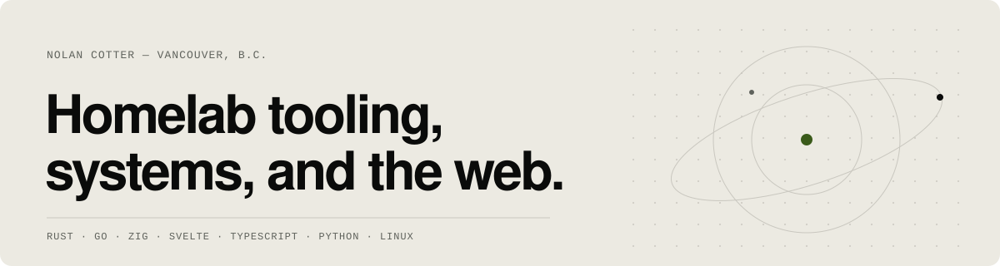

<picture>
  <source media="(prefers-color-scheme: dark)" srcset="assets/header-dark.svg">
  
</picture>

I build small, careful tools for the machines I run myself: homelab infrastructure that stays private by default, offline developer CLIs that never phone home, and the occasional experiment in rethinking the web from first principles.

&nbsp;

### Homelab

- **[ArrGate](https://github.com/NolanCotter/ArrGate)** — SSO and safe private networking for Docker media stacks. `Go`
- **[gatepass](https://github.com/NolanCotter/gatepass)** — Secure temporary access for private homelab services. `Go`
- **[labdns](https://github.com/NolanCotter/labdns)** — Safe, readable internal DNS names for homelab services. `Go`
- **[homelab-doctor](https://github.com/NolanCotter/homelab-doctor)** — Read-only Linux diagnostics for self-hosters. `Go`
- **[mcserver-setup](https://github.com/NolanCotter/mcserver-setup)** — A polished terminal wizard for reproducible Minecraft servers. `Rust`

### Developer tools

- **[RepoReady](https://github.com/NolanCotter/RepoReady)** — Offline release-readiness auditor for packaging, docs and Git mistakes. `Go`
- **[FlakeHarbor](https://github.com/NolanCotter/FlakeHarbor)** — Local-first analysis of JUnit test-result history. `Rust`
- **[sbom-lens](https://github.com/NolanCotter/sbom-lens)** — Explains what changed between two SPDX or CycloneDX SBOMs. `Rust`
- **[otel-pocket](https://github.com/NolanCotter/otel-pocket)** — A local OpenTelemetry receiver and viewer, no observability stack required. `Go`
- **[SecretSieve](https://github.com/NolanCotter/SecretSieve)** — Streaming secret redaction for CI logs and terminal output. `Rust`
- **[wasi-matrix](https://github.com/NolanCotter/wasi-matrix)** — Records which WebAssembly modules work on which local runtimes. `Rust`

### Experiments

- **[nexus-web](https://github.com/NolanCotter/nexus-web)** — An alternative web architecture built from first principles. `Rust`
- **[AirBridge](https://github.com/NolanCotter/AirBridge)** — Mirror and control an iPhone from Linux over AirPlay and Bluetooth. `Python`
- **[svelte-tool-dashboard](https://github.com/NolanCotter/svelte-tool-dashboard)** — New Svelte tools and libraries, aggregated daily. `Svelte`

&nbsp;

[nolancotter.ca](https://nolancotter.ca) &nbsp;·&nbsp; [LinkedIn](https://www.linkedin.com/in/nolan-cotter-989025391/) &nbsp;·&nbsp; Vancouver, B.C.
